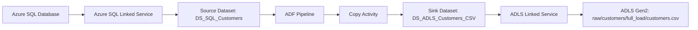
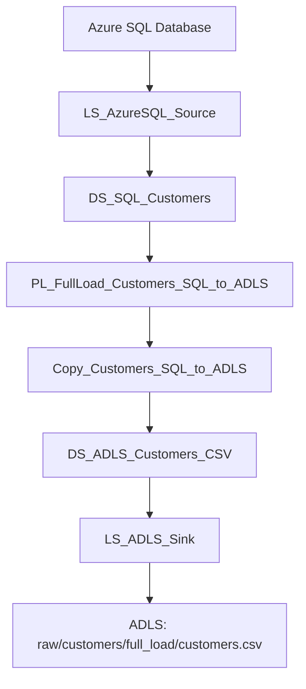

# Azure Data Factory Lab Guide 01  
## Full Load: Azure SQL Database `customers` Table to ADLS Gen2

**Duration:** 2 hours  
**Level:** Beginner  
**Objective:** Build your first Azure Data Factory pipeline to copy the complete `customers` table from Azure SQL Database into ADLS Gen2 as a CSV file.

---

## Index

1. [What You Will Build](#1-what-you-will-build)
2. [Architecture Flow](#2-architecture-flow)
3. [Naming Conventions](#3-naming-conventions)
4. [Prerequisites](#4-prerequisites)
5. [Create or Verify Source Table](#5-create-or-verify-source-table)
6. [Prepare ADLS Folder Structure](#6-prepare-adls-folder-structure)
7. [Open ADF Studio](#7-open-adf-studio)
8. [Create Azure SQL Linked Service](#8-create-azure-sql-linked-service)
9. [Create ADLS Linked Service](#9-create-adls-linked-service)
10. [Create Source Dataset](#10-create-source-dataset)
11. [Create Sink Dataset](#11-create-sink-dataset)
12. [Create Pipeline](#12-create-pipeline)
13. [Add Copy Activity](#13-add-copy-activity)
14. [Configure Source](#14-configure-source)
15. [Configure Sink](#15-configure-sink)
16. [Configure Mapping](#16-configure-mapping)
17. [Validate Pipeline](#17-validate-pipeline)
18. [Run Using Debug](#18-run-using-debug)
19. [Publish Changes](#19-publish-changes)
20. [Run Again Using Trigger Now](#20-run-again-using-trigger-now)
21. [Monitor Pipeline Run](#21-monitor-pipeline-run)
22. [Verify Output in ADLS](#22-verify-output-in-adls)
23. [Debug vs Trigger Now](#23-debug-vs-trigger-now)
24. [Final Checklist](#24-final-checklist)
25. [Common Errors and Fixes](#25-common-errors-and-fixes)
26. [What You Built](#26-what-you-built)
27. [Next Step](#27-next-step)

---

# 1. What You Will Build

In this lab, you will build an ADF pipeline that copies data from Azure SQL Database to ADLS Gen2.

```text
Azure SQL Database
    ↓
Azure Data Factory Copy Activity
    ↓
ADLS Gen2
    ↓
raw/customers/full_load/customers.csv
```

This is a **full-load ingestion pipeline**.

A **full load** means the pipeline copies the complete table every time it runs.

---

# 2. Architecture Flow



---

# 3. Naming Conventions

Use consistent names. This makes the project easy to understand and maintain.

## 3.1 Azure Resource Naming

Use this general pattern:

```text
<resource-type>-<project>-<purpose>-<environment>-<region>-<number>
```

For this lab:

| Part | Value | Meaning |
|---|---|---|
| `project` | `de` | Data Engineering |
| `purpose` | `adf` | Azure Data Factory lab |
| `environment` | `dev` | Development |
| `region` | `cin` | Central India |
| `number` | `001` | Resource sequence number |

Recommended Azure resource names:

| Azure Resource | Recommended Name |
|---|---|
| Resource Group | `rg-de-adf-dev-cin-001` |
| Azure Data Factory | `adf-de-adf-dev-cin-001` |
| Storage Account | `stdeadfdevcin001` |
| ADLS Container | `adf-demo` |
| Azure SQL Server | `sqlsrv-de-adf-dev-cin-001` |
| Azure SQL Database | `sqldb_adf_demo` |

> **Note:** Storage account names must be lowercase and should not contain hyphens. ADF names must be globally unique. If your ADF name is already taken, add your name or initials.

Example:

```text
adf-sandeep-de-adf-dev-cin-001
stsdpadfdevcin001
```

---

## 3.2 ADF Artifact Naming

Inside ADF, use **underscores** for artifact names.

| ADF Object | Prefix | Recommended Name |
|---|---:|---|
| Linked Service | `LS` | `LS_AzureSQL_Source` |
| Linked Service | `LS` | `LS_ADLS_Sink` |
| Dataset | `DS` | `DS_SQL_Customers` |
| Dataset | `DS` | `DS_ADLS_Customers_CSV` |
| Pipeline | `PL` | `PL_FullLoad_Customers_SQL_to_ADLS` |
| Activity | `Copy` | `Copy_Customers_SQL_to_ADLS` |

Meaning:

| Prefix | Meaning |
|---|---|
| `LS` | Linked Service |
| `DS` | Dataset |
| `PL` | Pipeline |
| `Copy` | Copy Activity |

---

# 4. Prerequisites

Before starting, make sure you have:

| Requirement | Status |
|---|---|
| Azure subscription | Required |
| Azure Data Factory created | Required |
| Azure SQL Database created | Required |
| ADLS Gen2 storage account created | Required |
| ADLS container created | Required |
| ADF Studio opened | Required |
| SQL username and password available | Required |

You will use these ADF Studio sections:

| Section | Purpose |
|---|---|
| **Author** | Create datasets and pipelines |
| **Manage** | Create linked services |
| **Monitor** | Check pipeline runs |

---

# 5. Create or Verify Source Table

Open **Azure SQL Database → Query editor**.

First, check the current database:

```sql
SELECT DB_NAME() AS current_database;
```

Create the `customers` table:

```sql
CREATE TABLE dbo.customers (
    customer_id INT PRIMARY KEY,
    first_name VARCHAR(50),
    last_name VARCHAR(50),
    email VARCHAR(100),
    address VARCHAR(200),
    phone_number VARCHAR(20),
    isDeleted BIT,
    lastmodified DATETIME2
);
```

Insert sample data:

```sql
INSERT INTO dbo.customers
(customer_id, first_name, last_name, email, address, phone_number, isDeleted, lastmodified)
VALUES
(1, 'Amit', 'Sharma', 'amit@example.com', 'Pune', '9876543210', 0, SYSDATETIME()),
(2, 'Priya', 'Verma', 'priya@example.com', 'Mumbai', '9876543211', 0, SYSDATETIME()),
(3, 'Rahul', 'Patil', 'rahul@example.com', 'Nagpur', '9876543212', 0, SYSDATETIME()),
(4, 'Sneha', 'Joshi', 'sneha@example.com', 'Bengaluru', '9876543213', 0, SYSDATETIME());
```

Verify the table:

```sql
SELECT * FROM dbo.customers;
```

Expected columns:

| Column Name |
|---|
| `customer_id` |
| `first_name` |
| `last_name` |
| `email` |
| `address` |
| `phone_number` |
| `isDeleted` |
| `lastmodified` |

> If your actual table name is different, use the exact same table name in ADF.

Example:

```sql
SELECT * FROM dbo.customer_table;
```

---

# 6. Prepare ADLS Folder Structure

Use this container:

```text
adf-demo
```

Create this folder structure:

```text
raw/
  customers/
    full_load/
```

Final expected file path:

```text
adf-demo/raw/customers/full_load/customers.csv
```

---

# 7. Open ADF Studio

Follow this path:

```text
Azure Portal
    ↓
Data factories
    ↓
Open your Data Factory
    ↓
Launch Studio
```

You should now be inside ADF Studio.

---

# 8. Create Azure SQL Linked Service

A linked service stores connection information.

Go to:

```text
Manage
    ↓
Linked services
    ↓
New
    ↓
Search: Azure SQL Database
    ↓
Continue
```

Fill the details:

| Field | Value |
|---|---|
| Name | `LS_AzureSQL_Source` |
| Connect via integration runtime | `AutoResolveIntegrationRuntime` |
| Account selection method | `From Azure subscription` |
| Azure subscription | Select your subscription |
| Server name | Select your Azure SQL Server |
| Database name | `sqldb_adf_demo` or your database name |
| Authentication type | SQL authentication |
| User name | Your SQL username |
| Password | Your SQL password |

Then click:

```text
Test connection
    ↓
Create
```

If the connection fails, check:

- SQL username and password
- Azure SQL firewall settings
- Correct SQL server selected
- Correct database selected

---

# 9. Create ADLS Linked Service

Go to:

```text
Manage
    ↓
Linked services
    ↓
New
    ↓
Search: Azure Data Lake Storage Gen2
    ↓
Continue
```

Fill the details:

| Field | Value |
|---|---|
| Name | `LS_ADLS_Sink` |
| Connect via integration runtime | `AutoResolveIntegrationRuntime` |
| Authentication method | Account key |
| Account selection method | From Azure subscription |
| Azure subscription | Select your subscription |
| Storage account name | Select your ADLS storage account |

Then click:

```text
Test connection
    ↓
Create
```

---

# 10. Create Source Dataset

A dataset points to the actual table, file, or folder.

Go to:

```text
Author
    ↓
Datasets
    ↓
New dataset
    ↓
Search: Azure SQL Database
    ↓
Continue
```

Fill the details:

| Field | Value |
|---|---|
| Name | `DS_SQL_Customers` |
| Linked service | `LS_AzureSQL_Source` |
| Table name | `dbo.customers` |

Click:

```text
OK
```

Now open the dataset and click:

```text
Preview data
```

Expected result:

```text
You should see customer records.
```

If preview fails, check:

- Table exists or not
- Schema name is correct or not
- Database selection is correct or not

Useful SQL check:

```sql
SELECT 
    TABLE_SCHEMA,
    TABLE_NAME
FROM INFORMATION_SCHEMA.TABLES
WHERE TABLE_NAME LIKE '%customer%';
```

---

# 11. Create Sink Dataset

Go to:

```text
Author
    ↓
Datasets
    ↓
New dataset
    ↓
Search: Azure Data Lake Storage Gen2
    ↓
Continue
    ↓
Select format: DelimitedText
    ↓
Continue
```

Fill the details:

| Field | Value |
|---|---|
| Name | `DS_ADLS_Customers_CSV` |
| Linked service | `LS_ADLS_Sink` |
| File path | `adf-demo/raw/customers/full_load/` |
| File name | `customers.csv` |
| First row as header | Checked |
| Import schema | None |

Click:

```text
OK
```

For this first lab, use CSV because it is easy to verify.

---

# 12. Create Pipeline

A pipeline is a workflow.

Go to:

```text
Author
    ↓
Pipelines
    ↓
New pipeline
```

Rename the pipeline:

```text
PL_FullLoad_Customers_SQL_to_ADLS
```

---

# 13. Add Copy Activity

Inside the pipeline canvas:

```text
Activities
    ↓
Move & Transform
    ↓
Drag Copy data activity to the canvas
```

Rename the activity:

```text
Copy_Customers_SQL_to_ADLS
```

---

# 14. Configure Source

Click the Copy Activity.

Go to:

```text
Source tab
```

Set:

| Field | Value |
|---|---|
| Source dataset | `DS_SQL_Customers` |
| Use query | `Table` |
| Table | `dbo.customers` |

For this lab, use **Table mode**.

Do not use query mode yet. Query mode will be used later for incremental load.

---

# 15. Configure Sink

Go to:

```text
Sink tab
```

Set:

| Field | Value |
|---|---|
| Sink dataset | `DS_ADLS_Customers_CSV` |
| Copy behavior | Default / None |

---

# 16. Configure Mapping

Go to:

```text
Mapping tab
```

For the first successful run:

```text
Do not add manual mapping rows.
Leave mapping empty.
```

ADF can automatically copy columns for this basic Azure SQL to CSV copy.

If you already added a blank mapping row and see this error:

```text
Mapping source is empty
```

Fix it like this:

```text
Select the blank mapping row
    ↓
Delete it
    ↓
Validate again
```

Manual mapping is useful when you want to:

- Rename columns
- Exclude columns
- Reorder columns
- Change column mapping explicitly

For this first lab, keep it simple.

---

# 17. Validate Pipeline

Click:

```text
Validate
```

Expected result:

```text
No errors
```

If validation fails, check:

- Source dataset
- Sink dataset
- Table name
- File path
- Blank mapping rows
- Linked service connections

---

# 18. Run Using Debug

Click:

```text
Debug
```

Important:

```text
Debug actually runs the pipeline.
It is not a dry run.
It will write data to ADLS.
```

Wait for the result:

```text
Status: Succeeded
```

---

# 19. Publish Changes

After successful debug, click:

```text
Publish all
```

Publishing saves your changes as the active version of the data factory.

---

# 20. Run Again Using Trigger Now

After publishing, run the pipeline manually using **Trigger now**.

Go to:

```text
Open pipeline
    ↓
Add trigger
    ↓
Trigger now
    ↓
OK
```

Use this rule:

| Action | When to Use |
|---|---|
| Debug | While developing/testing |
| Trigger now | Manual run after publishing |
| Schedule trigger | Automatic time-based run |

---

# 21. Monitor Pipeline Run

Go to:

```text
Monitor
    ↓
Pipeline runs
```

Open the latest pipeline run.

Check:

| Item | What to Check |
|---|---|
| Status | Succeeded / Failed |
| Duration | How long the run took |
| Rows copied | Number of copied rows |
| Data read | Amount of source data read |
| Data written | Amount of sink data written |
| Activity details | Copy Activity execution details |

---

# 22. Verify Output in ADLS

Go to Azure Portal:

```text
Storage account
    ↓
Containers
    ↓
adf-demo
    ↓
raw
    ↓
customers
    ↓
full_load
    ↓
customers.csv
```

Open or download the file.

Expected output:

```csv
customer_id,first_name,last_name,email,address,phone_number,isDeleted,lastmodified
1,Amit,Sharma,amit@example.com,Pune,9876543210,False,...
2,Priya,Verma,priya@example.com,Mumbai,9876543211,False,...
3,Rahul,Patil,rahul@example.com,Nagpur,9876543212,False,...
4,Sneha,Joshi,sneha@example.com,Bengaluru,9876543213,False,...
```

---

# 23. Debug vs Trigger Now

Both **Debug** and **Trigger now** run the pipeline.

| Point | Debug | Trigger Now |
|---|---|---|
| Purpose | Development/testing | Proper manual execution |
| Requires publish? | No | Yes, recommended |
| Actually runs pipeline? | Yes | Yes |
| Writes data to ADLS? | Yes | Yes |
| Best use | While building | After pipeline is ready |
| Output visible in | Pipeline canvas output panel | Monitor section |

Simple rule:

```text
During development  → Debug
After publishing    → Trigger now
For scheduled run   → Schedule trigger
```

---

# 24. Final Checklist

Before marking the lab complete, confirm:

| Check | Status |
|---|---|
| Azure SQL linked service test connection succeeded | ☐ |
| ADLS linked service test connection succeeded | ☐ |
| Source dataset preview data worked | ☐ |
| Sink dataset points to correct ADLS folder | ☐ |
| Pipeline validation passed | ☐ |
| Debug run succeeded | ☐ |
| Publish all completed | ☐ |
| Trigger now run succeeded | ☐ |
| `customers.csv` is visible in ADLS | ☐ |
| File contains rows from Azure SQL table | ☐ |

---

# 25. Common Errors and Fixes

| Error | Reason | Fix |
|---|---|---|
| `Invalid object name 'dbo.customers'` | Wrong table name, schema, or database | Check exact table using `INFORMATION_SCHEMA.TABLES` |
| Source columns not visible in mapping | Source schema not imported or table not readable | Preview source dataset first |
| `Mapping source is empty` | Blank manual mapping row exists | Delete the blank mapping row |
| ADLS access denied | Storage permission or authentication issue | Recheck ADLS linked service |
| Test connection failed | Wrong credentials or firewall issue | Fix SQL credentials/firewall |
| File not visible in ADLS | Wrong sink path | Check container and folder path |
| Pipeline change not saved | Pipeline not published | Click `Publish all` |

---

# 26. What You Built



You successfully built a **full-load data ingestion pipeline**.

---

# 27. Next Step

The current pipeline copies the full table every time.

Next, this will be improved into a query-based incremental load pipeline:

```text
Read last watermark
    ↓
Copy records where lastmodified > previous watermark
    ↓
Write changed data to ADLS
    ↓
Update watermark
```

This will convert the basic full-load pipeline into a query-based CDC-style ingestion pipeline.

---

## Reference Links

- Azure Data Factory overview: <https://learn.microsoft.com/en-us/azure/data-factory/introduction>
- Copy Activity overview: <https://learn.microsoft.com/en-us/azure/data-factory/copy-activity-overview>
- ADF linked services: <https://learn.microsoft.com/en-us/azure/data-factory/concepts-linked-services>
- ADF naming rules: <https://learn.microsoft.com/en-us/azure/data-factory/naming-rules>
