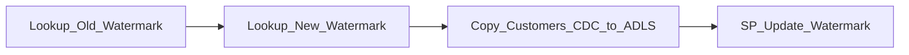
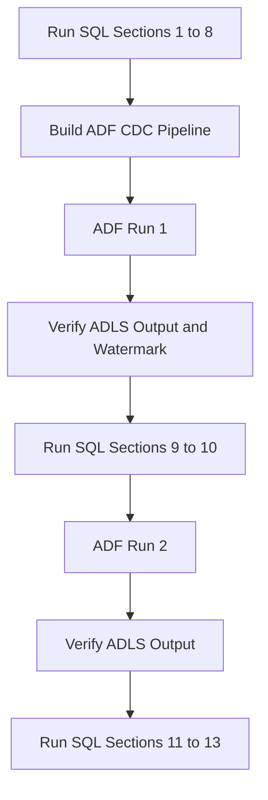
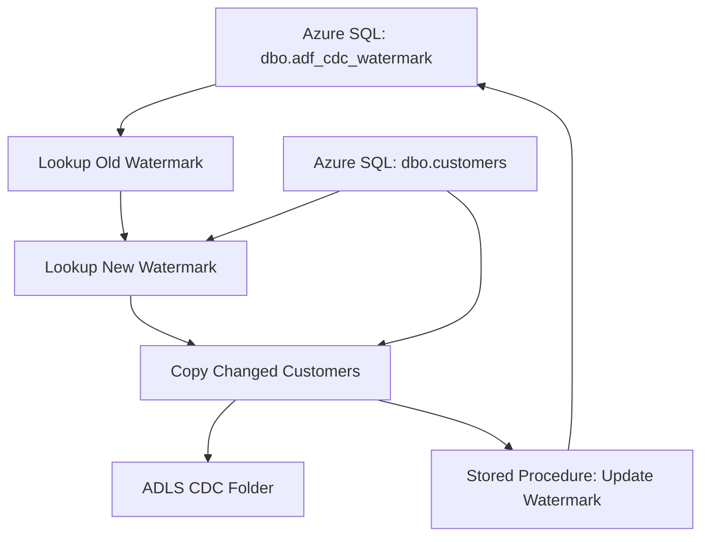
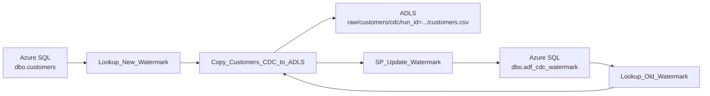
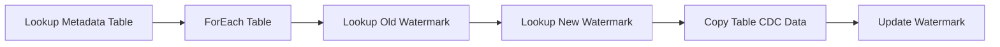

# Azure Data Factory Lab 02  
## Single-Table Query-Based CDC Prototype  
### Azure SQL `dbo.customers` → ADLS Gen2 using Watermark

**Duration:** 2 hours  
**Level:** Beginner to Intermediate  
**Focus:** ADF-side implementation only  
**Source table:** `dbo.customers`  
**CDC type:** Query-based CDC using `lastmodified` watermark  

---

## 1. Lab Goal

In this lab, you will build an Azure Data Factory pipeline that copies only new or modified records from Azure SQL Database to ADLS Gen2.

You will build this ADF pipeline:



The pipeline will:

1. Read the old watermark from Azure SQL.
2. Read the new maximum `lastmodified` value from `dbo.customers`.
3. Copy only changed records to ADLS.
4. Update the watermark after successful copy.

---

## 2. Important Note

This guide covers only the **ADF-side steps**.

For Azure SQL setup, use the separate SQL setup script.

---

## 3. SQL Script Sections to Refer

Before starting the ADF pipeline, complete these sections from the Azure SQL setup script:

| SQL Script Section | Purpose |
|---|---|
| Sections 1–8 | Create source table, insert initial data, create watermark table, create stored procedure, and verify setup |

After the first ADF run succeeds, return to SQL and run:

| SQL Script Section | Purpose |
|---|---|
| Sections 9–10 | Simulate CDC changes and verify changed rows |

After the second ADF run succeeds, run:

| SQL Script Section | Purpose |
|---|---|
| Sections 11–13 | Final verification and CDC limitation discussion |

---

## 4. Complete Execution Flow



---

## 5. Expected ADF Pipeline Architecture



---

## 6. ADF Objects Required

| Object Type | Name | Purpose |
|---|---|---|
| Linked Service | `LS_AzureSQL_Source` | Connect ADF to Azure SQL Database |
| Linked Service | `LS_ADLS_Sink` | Connect ADF to ADLS Gen2 |
| Dataset | `DS_SQL_Customers` | Points to `dbo.customers` |
| Dataset | `DS_SQL_Watermark` | Points to `dbo.adf_cdc_watermark` |
| Dataset | `DS_ADLS_Customers_CDC_CSV` | Points to CDC output path in ADLS |
| Pipeline | `PL_CDC_Customers_SQL_to_ADLS` | Main CDC pipeline |
| Lookup Activity | `Lookup_Old_Watermark` | Reads old watermark |
| Lookup Activity | `Lookup_New_Watermark` | Reads new max watermark |
| Copy Activity | `Copy_Customers_CDC_to_ADLS` | Copies changed records to ADLS |
| Stored Procedure Activity | `SP_Update_Watermark` | Updates watermark after copy |

---

## 7. Naming Convention Reminder

Use **underscores** in ADF artifact names.

Recommended prefixes:

| Prefix | Meaning |
|---|---|
| `LS` | Linked Service |
| `DS` | Dataset |
| `PL` | Pipeline |

Example:

```text
PL_CDC_Customers_SQL_to_ADLS
```

---

# Part A: Linked Services

## 8. Reuse Existing Linked Services

From the previous full-load lab, you should already have:

| Linked Service | Purpose |
|---|---|
| `LS_AzureSQL_Source` | Azure SQL source connection |
| `LS_ADLS_Sink` | ADLS sink connection |

Go to:

```text
ADF Studio
    ↓
Manage
    ↓
Linked services
```

Confirm both linked services exist and test the connection if needed.

---

# Part B: Datasets

## 9. Create or Verify Customers Source Dataset

Go to:

```text
Author
    ↓
Datasets
    ↓
New dataset
    ↓
Azure SQL Database
```

Create or verify this dataset:

| Field | Value |
|---|---|
| Dataset name | `DS_SQL_Customers` |
| Linked service | `LS_AzureSQL_Source` |
| Table name | `dbo.customers` |

After creating it, click:

```text
Preview data
```

Expected:

```text
Customer records should be visible.
```

---

## 10. Create Watermark Dataset

Go to:

```text
Author
    ↓
Datasets
    ↓
New dataset
    ↓
Azure SQL Database
```

Create:

| Field | Value |
|---|---|
| Dataset name | `DS_SQL_Watermark` |
| Linked service | `LS_AzureSQL_Source` |
| Table name | `dbo.adf_cdc_watermark` |

Click:

```text
Preview data
```

Expected:

```text
customers | lastmodified | 1900-01-01...
```

This row comes from **SQL Script Section 6**.

---

## 11. Create CDC Sink Dataset

Go to:

```text
Author
    ↓
Datasets
    ↓
New dataset
    ↓
Azure Data Lake Storage Gen2
    ↓
DelimitedText
```

Create:

| Field | Value |
|---|---|
| Dataset name | `DS_ADLS_Customers_CDC_CSV` |
| Linked service | `LS_ADLS_Sink` |
| Format | DelimitedText / CSV |
| First row as header | Checked |

---

## 12. Add Dataset Parameter to CDC Sink Dataset

Open:

```text
DS_ADLS_Customers_CDC_CSV
    ↓
Parameters
```

Add this parameter:

| Parameter Name | Type |
|---|---|
| `p_directory` | String |

---

## 13. Configure CDC Sink Dataset Connection

Go to:

```text
DS_ADLS_Customers_CDC_CSV
    ↓
Connection
```

Set:

| Field | Value |
|---|---|
| File system / Container | `adf-demo` |
| Directory | `@dataset().p_directory` |
| File name | `customers.csv` |

### What does `@dataset().p_directory` mean?

`@dataset().p_directory` means:

```text
Use the p_directory value passed to this dataset during pipeline execution.
```

It allows each pipeline run to write into a different folder.

Example runtime path:

```text
adf-demo/raw/customers/cdc/run_id=<pipeline_run_id>/customers.csv
```

---

# Part C: Pipeline Creation

## 14. Create CDC Pipeline

Go to:

```text
Author
    ↓
Pipelines
    ↓
New pipeline
```

Rename the pipeline:

```text
PL_CDC_Customers_SQL_to_ADLS
```

---

## 15. Final Pipeline Layout

Your final pipeline should look like this:


---

# Part D: Lookup Old Watermark

## 16. Add First Lookup Activity

Drag a **Lookup** activity onto the pipeline canvas.

Rename it exactly:

```text
Lookup_Old_Watermark
```

> The activity name is very important. Expressions later in the pipeline refer to this exact name.

---

## 17. Configure Lookup Old Watermark

Go to:

```text
Lookup_Old_Watermark
    ↓
Settings
```

Set:

| Field | Value |
|---|---|
| Source dataset | `DS_SQL_Watermark` |
| Use query | Query |
| First row only | Checked |

Use this query:

```sql
SELECT 
    CONVERT(VARCHAR(33), last_watermark, 126) AS last_watermark
FROM dbo.adf_cdc_watermark
WHERE source_table = 'customers';
```

Purpose:

```text
Reads the last successful watermark from dbo.adf_cdc_watermark.
```

---

# Part E: Lookup New Watermark

## 18. Add Second Lookup Activity

Drag another **Lookup** activity.

Rename it exactly:

```text
Lookup_New_Watermark
```

Connect the activities:

```text
Lookup_Old_Watermark success → Lookup_New_Watermark
```

---

## 19. Configure Lookup New Watermark

Go to:

```text
Lookup_New_Watermark
    ↓
Settings
```

Set:

| Field | Value |
|---|---|
| Source dataset | `DS_SQL_Customers` |
| Use query | Query |
| First row only | Checked |

Use this query:

```sql
SELECT 
    CONVERT(VARCHAR(33), MAX(lastmodified), 126) AS new_watermark
FROM dbo.customers;
```

Purpose:

```text
Gets the latest available lastmodified value from dbo.customers.
```

---

# Part F: Copy Changed Records to ADLS

## 20. Add Copy Activity

Drag a **Copy data** activity.

Rename it exactly:

```text
Copy_Customers_CDC_to_ADLS
```

Connect:

```text
Lookup_New_Watermark success → Copy_Customers_CDC_to_ADLS
```

---

## 21. Configure Copy Activity Source

Go to:

```text
Copy_Customers_CDC_to_ADLS
    ↓
Source
```

Set:

| Field | Value |
|---|---|
| Source dataset | `DS_SQL_Customers` |
| Use query | Query |

Click **Add dynamic content** in the query box and paste this expression:

```text
@concat(
'SELECT customer_id, first_name, last_name, email, address, phone_number, isDeleted, lastmodified
 FROM dbo.customers
 WHERE lastmodified > CONVERT(datetime2(3), ''',
activity('Lookup_Old_Watermark').output.firstRow.last_watermark,
''', 126) AND lastmodified <= CONVERT(datetime2(3), ''',
activity('Lookup_New_Watermark').output.firstRow.new_watermark,
''', 126)'
)
```

CDC filter logic:

```sql
WHERE lastmodified > old_watermark
  AND lastmodified <= new_watermark
```

---

## 22. Why Use Old and New Watermark?

| Watermark | Meaning |
|---|---|
| Old watermark | Last successfully processed timestamp |
| New watermark | Current maximum `lastmodified` value in source table |

The copy activity reads records between these two values.

This prevents already-processed rows from being copied repeatedly.

---

## 23. Configure Copy Activity Sink

Go to:

```text
Copy_Customers_CDC_to_ADLS
    ↓
Sink
```

Set:

| Field | Value |
|---|---|
| Sink dataset | `DS_ADLS_Customers_CDC_CSV` |

For dataset parameter `p_directory`, enter dynamic content:

```text
@concat('raw/customers/cdc/run_id=', pipeline().RunId)
```

Final output path:

```text
adf-demo/raw/customers/cdc/run_id=<pipeline_run_id>/customers.csv
```

---

## 24. Configure Mapping

Go to:

```text
Copy_Customers_CDC_to_ADLS
    ↓
Mapping
```

For this lab:

```text
Leave mapping empty.
Do not add blank manual mapping rows.
```

If you see:

```text
Mapping source is empty
```

Fix:

```text
Delete the blank mapping row.
```

---

# Part G: Update Watermark

## 25. Add Stored Procedure Activity

Drag a **Stored Procedure** activity.

Rename it exactly:

```text
SP_Update_Watermark
```

Connect:

```text
Copy_Customers_CDC_to_ADLS success → SP_Update_Watermark
```

Important:

```text
The watermark must update only after Copy Activity succeeds.
```

---

## 26. Configure Stored Procedure Activity

Go to:

```text
SP_Update_Watermark
    ↓
Settings
```

Set:

| Field | Value |
|---|---|
| Linked service | `LS_AzureSQL_Source` |
| Stored procedure name | `dbo.usp_update_adf_watermark` |

The stored procedure is created in **SQL Script Section 7**.

---

## 27. Add Stored Procedure Parameters

Add these parameters:

| Parameter | Type | Value |
|---|---|---|
| `source_table` | String | `customers` |
| `new_watermark` | String | `@activity('Lookup_New_Watermark').output.firstRow.new_watermark` |

---

# Part H: Validate and Run

## 28. Validate Pipeline

Click:

```text
Validate
```

Expected:

```text
No errors
```

---

## 29. Debug Run 1

Click:

```text
Debug
```

Important:

```text
Debug actually runs the pipeline.
It writes data to ADLS.
It updates the watermark table.
```

Because the initial watermark from **SQL Script Section 6** is:

```text
1900-01-01
```

Run 1 should copy all initial records.

Expected output:

```text
adf-demo/raw/customers/cdc/run_id=<run_id>/customers.csv
```

---

## 30. Verify After Run 1

After Run 1 succeeds:

1. Check the ADLS output folder.
2. Check the watermark table using the SQL verification section.

Use:

| SQL Script Section | Purpose |
|---|---|
| Section 11 or Section 8 | Verify watermark and source data |

Expected:

```text
last_watermark should become MAX(lastmodified) from dbo.customers.
```

---

# Part I: Simulate CDC Changes

## 31. Run SQL Sections 9–10

After ADF Run 1 succeeds, return to Azure SQL.

Run:

| SQL Script Section | Purpose |
|---|---|
| Section 9 | Simulate one update, one insert, and one soft delete |
| Section 10 | Verify changed rows before second ADF run |

Expected changed records:

| customer_id | Change Type |
|---|---|
| `2` | Updated |
| `5` | Inserted |
| `4` | Soft deleted |

---

# Part J: Run Incremental CDC

## 32. Debug Run 2

Return to ADF and run the same pipeline again.

Use:

```text
Debug
```

or after publishing:

```text
Add trigger
    ↓
Trigger now
```

Expected:

```text
Only changed rows should be copied.
```

Expected output path:

```text
adf-demo/raw/customers/cdc/run_id=<new_run_id>/customers.csv
```

---

## 33. Verify Run 2 Output

Open the new ADLS run folder and check `customers.csv`.

Expected records:

| customer_id | Expected Reason |
|---|---|
| `2` | Updated phone number |
| `5` | Newly inserted record |
| `4` | Soft delete record |

---

# Part K: Final Verification

## 34. Run SQL Sections 11–13

After Run 2 succeeds, return to Azure SQL and run:

| SQL Script Section | Purpose |
|---|---|
| Section 11 | Final verification |
| Section 12 | Optional manual delta query |
| Section 13 | CDC limitation discussion |

---

# Part L: Important Troubleshooting

## 35. Activity Name Mismatch Error

You may see an error like:

```text
ErrorCode=InvalidTemplate
The action(s) 'Lookup_Old_Watermark' referenced by inputs in action 
'Copy_Customers_CDC_to_ADLSComposeRuntimeVariables' are not defined in the template.
```

### Reason

Your expression refers to:

```text
activity('Lookup_Old_Watermark')
```

but your actual Lookup activity has a different name.

For example:

```text
Lookup_Old_Watermark
```

is different from:

```text
Lookup_Old_Watermark1
Lookup Old Watermark
Lookup_OldWatermark
```

### Fix

Rename the activity exactly as used in the expression.

Required activity names:

| Activity | Exact Name Required |
|---|---|
| Old watermark lookup | `Lookup_Old_Watermark` |
| New watermark lookup | `Lookup_New_Watermark` |
| Copy activity | `Copy_Customers_CDC_to_ADLS` |
| Stored procedure activity | `SP_Update_Watermark` |

---

## 36. Common Errors and Fixes

| Error | Likely Reason | Fix |
|---|---|---|
| `InvalidTemplate` activity not defined | Activity name mismatch | Rename activity or update expression |
| `Mapping source is empty` | Blank mapping row exists | Delete blank mapping row |
| `Invalid object name` | Wrong SQL table/schema/database | Verify SQL setup sections |
| No data copied in Run 2 | No rows changed after watermark | Run SQL Sections 9–10 |
| File not visible in ADLS | Wrong sink path or dataset parameter | Check `p_directory` value |
| Stored procedure failed | Parameter mismatch | Check `source_table` and `new_watermark` parameters |
| Watermark not updated | SP activity not connected after copy success | Connect Copy success to Stored Procedure |

---

# Part M: Final Summary

You built this CDC pipeline:



The pipeline performs:

```text
1. Read old watermark.
2. Read new watermark.
3. Copy records changed between old and new watermark.
4. Write output to ADLS in run-wise folder.
5. Update watermark after successful copy.
```

---

## 37. CDC Limitations to Explain

| Scenario | Detected? | Reason |
|---|---|---|
| Insert | Yes | New `lastmodified` value |
| Update | Yes | Updated `lastmodified` value |
| Soft delete | Yes | `isDeleted = 1` and `lastmodified` changes |
| Hard delete | No | Deleted row is no longer available to query |
| Multiple updates between two runs | Latest state only | Query reads current row state |
| Update without changing `lastmodified` | No | Watermark column does not change |
| Late record with older timestamp | Risky | It may fall before the current watermark |

Final line:

```text
This is query-based CDC using a watermark column. 
It is not database log-based CDC.
```

---

## 38. Next Lab Preview

In the next lab, you can extend this prototype to multiple tables using metadata-driven ingestion.

Next pipeline idea:


