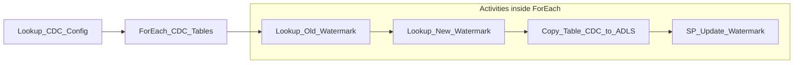
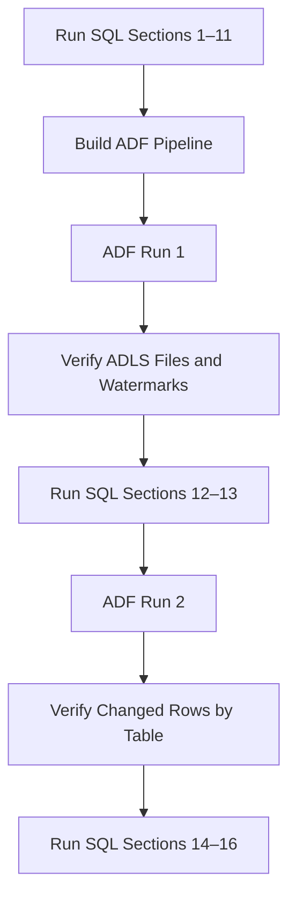
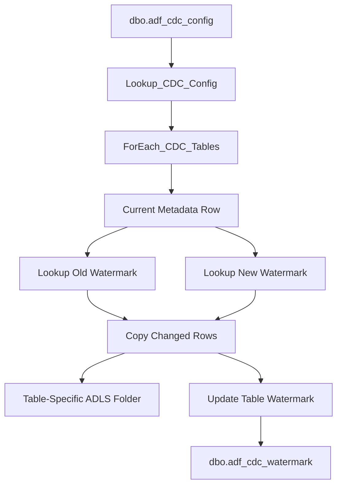

# Azure Data Factory Lab 03
## Metadata-Driven Multiple-Table Query-Based CDC
### Azure SQL Database to ADLS Gen2

**Level:** Beginner to intermediate  
**Source tables:** `dbo.customers`, `dbo.products`, `dbo.orders`  
**CDC type:** Query-based CDC using a watermark column

---

## 1. Lab Goal

In this lab, you will extend the single-table CDC prototype into one reusable pipeline that processes multiple tables.

The pipeline will:

1. Read the active table list from a configuration table.
2. Loop through the table list.
3. Read the old and new watermark for each table.
4. Copy only changed rows to ADLS.
5. Write each table to its own folder.
6. Update each table watermark after a successful copy.

---

## 2. Final Pipeline Flow



---

## 3. Why Use a Metadata-Driven Pipeline?

Without metadata-driven ingestion:

```text
customers → separate pipeline
products  → separate pipeline
orders    → separate pipeline
```

With metadata-driven ingestion:

```text
One configuration table
        ↓
One reusable pipeline
        ↓
Multiple source tables
```

| Benefit | Explanation |
|---|---|
| Less duplication | One pipeline processes all configured tables |
| Easier maintenance | Pipeline logic is updated in one place |
| Easy expansion | Add a new table through metadata |
| Consistency | All tables follow the same CDC pattern |
| Better project design | Similar to production ingestion frameworks |

---

## 4. SQL Script Reference

Use the separate file:

```text
adf_lab_03_multiple_table_cdc_azure_sql_setup.sql
```

| Stage | SQL Sections to Run |
|---|---|
| Before ADF Run 1 | Sections 1–11 |
| Before ADF Run 2 | Sections 12–13 |
| Final verification | Sections 14–16 |

---

## 5. Complete Execution Flow



---

## 6. ADF Objects Required

### Reuse Existing Linked Services

| Object | Name |
|---|---|
| Azure SQL linked service | `LS_AzureSQL_Source` |
| ADLS linked service | `LS_ADLS_Sink` |

### Create Datasets

| Dataset | Purpose |
|---|---|
| `DS_SQL_CDC_Config` | Reads active table metadata |
| `DS_SQL_CDC_Watermark` | Reads table watermark values |
| `DS_SQL_GenericTable` | Reusable source dataset for any table |
| `DS_ADLS_CDC_CSV` | Reusable ADLS sink dataset |

### Create Pipeline and Activities

| Object | Name |
|---|---|
| Pipeline | `PL_CDC_Multiple_Tables_SQL_to_ADLS` |
| Lookup | `Lookup_CDC_Config` |
| ForEach | `ForEach_CDC_Tables` |
| Lookup inside ForEach | `Lookup_Old_Watermark` |
| Lookup inside ForEach | `Lookup_New_Watermark` |
| Copy Activity inside ForEach | `Copy_Table_CDC_to_ADLS` |
| Stored Procedure inside ForEach | `SP_Update_Watermark` |

> Activity names must match the names used in expressions exactly.

---

# Part A: Create the Datasets

## 7. Create CDC Configuration Dataset

Go to:

```text
Author
    ↓
Datasets
    ↓
New dataset
    ↓
Azure SQL Database
```

Create:

| Field | Value |
|---|---|
| Name | `DS_SQL_CDC_Config` |
| Linked service | `LS_AzureSQL_Source` |
| Table | `dbo.adf_cdc_config` |

Click **Preview data**.

Expected source tables:

```text
customers
products
orders
```

The metadata is created in **SQL Sections 7–8**.

---

## 8. Create CDC Watermark Dataset

Create another Azure SQL dataset:

| Field | Value |
|---|---|
| Name | `DS_SQL_CDC_Watermark` |
| Linked service | `LS_AzureSQL_Source` |
| Table | `dbo.adf_cdc_watermark` |

Click **Preview data**.

Expected: one watermark row for each configured table.

The table is prepared in **SQL Sections 9–10**.

---

## 9. Create Generic Azure SQL Source Dataset

Create another Azure SQL dataset:

| Field | Value |
|---|---|
| Name | `DS_SQL_GenericTable` |
| Linked service | `LS_AzureSQL_Source` |

### Add Dataset Parameters

Open the **Parameters** tab and add:

| Parameter | Type |
|---|---|
| `p_schema` | String |
| `p_table` | String |

### Configure the Table Property

Open the **Connection** tab and set the table using dynamic content:

```text
@concat(dataset().p_schema, '.', dataset().p_table)
```

Meaning:

```text
Use the schema and table passed by the current ForEach iteration.
```

Example:

```text
p_schema = dbo
p_table  = products

Resolved table = dbo.products
```

---

## 10. Create Generic ADLS CDC Sink Dataset

Create:

```text
Author
    ↓
Datasets
    ↓
New dataset
    ↓
Azure Data Lake Storage Gen2
    ↓
DelimitedText
```

Set:

| Field | Value |
|---|---|
| Name | `DS_ADLS_CDC_CSV` |
| Linked service | `LS_ADLS_Sink` |
| First row as header | Checked |

### Add Dataset Parameters

| Parameter | Type |
|---|---|
| `p_directory` | String |
| `p_file_name` | String |

### Configure the Connection

| Field | Value |
|---|---|
| File system/container | `adf-demo` |
| Directory | `@dataset().p_directory` |
| File name | `@dataset().p_file_name` |

The pipeline will pass the folder and file name at runtime.

---

# Part B: Create the Main Pipeline

## 11. Create Pipeline

Go to:

```text
Author
    ↓
Pipelines
    ↓
New pipeline
```

Rename it:

```text
PL_CDC_Multiple_Tables_SQL_to_ADLS
```

---

# Part C: Read the Active Table List

## 12. Add Configuration Lookup

Add a **Lookup** activity.

Rename it exactly:

```text
Lookup_CDC_Config
```

Configure:

| Setting | Value |
|---|---|
| Source dataset | `DS_SQL_CDC_Config` |
| Use query | Query |
| First row only | Unchecked |

Query:

```sql
SELECT
    source_schema,
    source_table,
    watermark_column,
    target_directory
FROM dbo.adf_cdc_config
WHERE is_active = 1
ORDER BY load_order;
```

### Why is First Row Only unchecked?

The Lookup must return all active table rows, not just one table.

The list is available as:

```text
@activity('Lookup_CDC_Config').output.value
```

---

# Part D: Loop Through the Tables

## 13. Add ForEach Activity

Add a **ForEach** activity.

Rename it:

```text
ForEach_CDC_Tables
```

Connect:

```text
Lookup_CDC_Config success → ForEach_CDC_Tables
```

Set **Items**:

```text
@activity('Lookup_CDC_Config').output.value
```

For the beginner lab, enable:

```text
Sequential = true
```

This processes one table at a time and makes debugging easier.

---

## 14. Understand `item()`

Inside the ForEach activity:

```text
@item()
```

means the current metadata row.

| Expression | Example Value |
|---|---|
| `@item().source_schema` | `dbo` |
| `@item().source_table` | `products` |
| `@item().watermark_column` | `lastmodified` |
| `@item().target_directory` | `raw/products/cdc` |

---

# Part E: Build the Activities Inside ForEach

Open the ForEach activity and create this flow:


---

## 15. Add Lookup Old Watermark

Add a Lookup activity inside ForEach.

Rename it exactly:

```text
Lookup_Old_Watermark
```

Configure:

| Setting | Value |
|---|---|
| Source dataset | `DS_SQL_CDC_Watermark` |
| Use query | Query |
| First row only | Checked |

Use dynamic content for the query:

```text
@concat(
'SELECT CONVERT(VARCHAR(33), last_watermark, 126) AS last_watermark
 FROM dbo.adf_cdc_watermark
 WHERE source_schema = ''',
item().source_schema,
''' AND source_table = ''',
item().source_table,
''''
)
```

Purpose:

```text
Read the last successful watermark for the current table.
```

---

## 16. Add Lookup New Watermark

Add another Lookup activity.

Rename it exactly:

```text
Lookup_New_Watermark
```

Connect it after `Lookup_Old_Watermark`.

Select dataset:

```text
DS_SQL_GenericTable
```

Pass dataset parameters:

| Parameter | Value |
|---|---|
| `p_schema` | `@item().source_schema` |
| `p_table` | `@item().source_table` |

Use dynamic content for the query:

```text
@concat(
'SELECT CONVERT(VARCHAR(33), MAX([',
item().watermark_column,
']), 126) AS new_watermark
 FROM [',
item().source_schema,
'].[',
item().source_table,
']'
)
```

Purpose:

```text
Find the latest watermark currently available in the source table.
```

---

## 17. Add Copy Activity

Add a Copy Data activity.

Rename it exactly:

```text
Copy_Table_CDC_to_ADLS
```

Connect it after `Lookup_New_Watermark`.

### Configure the Source Dataset

Select:

```text
DS_SQL_GenericTable
```

Pass:

| Parameter | Value |
|---|---|
| `p_schema` | `@item().source_schema` |
| `p_table` | `@item().source_table` |

### Add the Dynamic Source Query

Use:

```text
@concat(
'SELECT * FROM [',
item().source_schema,
'].[',
item().source_table,
']
 WHERE [',
item().watermark_column,
'] > CONVERT(datetime2(3), ''',
activity('Lookup_Old_Watermark').output.firstRow.last_watermark,
''', 126)
 AND [',
item().watermark_column,
'] <= CONVERT(datetime2(3), ''',
activity('Lookup_New_Watermark').output.firstRow.new_watermark,
''', 126)'
)
```

CDC filter:

```sql
watermark_column > old_watermark
AND watermark_column <= new_watermark
```

### Configure the Sink Dataset

Select:

```text
DS_ADLS_CDC_CSV
```

Pass:

| Parameter | Dynamic Value |
|---|---|
| `p_directory` | `@concat(item().target_directory, '/run_id=', pipeline().RunId)` |
| `p_file_name` | `@concat(item().source_table, '.csv')` |

Example paths:

```text
adf-demo/raw/customers/cdc/run_id=<run-id>/customers.csv
adf-demo/raw/products/cdc/run_id=<run-id>/products.csv
adf-demo/raw/orders/cdc/run_id=<run-id>/orders.csv
```

### Mapping

Leave mapping empty for this lab.

Do not add a blank manual mapping row.

---

## 18. Add Stored Procedure Activity

Add a Stored Procedure activity.

Rename it exactly:

```text
SP_Update_Watermark
```

Connect it after `Copy_Table_CDC_to_ADLS` using the success path.

Configure:

| Setting | Value |
|---|---|
| Linked service | `LS_AzureSQL_Source` |
| Stored procedure | `dbo.usp_update_adf_watermark` |

The procedure is created in **SQL Section 10**.

Add parameters:

| Parameter | Type | Dynamic Value |
|---|---|---|
| `source_schema` | String | `@item().source_schema` |
| `source_table` | String | `@item().source_table` |
| `new_watermark` | String | `@activity('Lookup_New_Watermark').output.firstRow.new_watermark` |

Important:

```text
Update the watermark only after the current table copy succeeds.
```

---

# Part F: Validate and Run

## 19. Validate the Pipeline

Click:

```text
Validate
```

Expected:

```text
No errors
```

| Problem | What to Check |
|---|---|
| Activity not defined | Activity name differs from expression |
| Dataset parameter missing | Parameter name/value is missing |
| Dynamic query error | Missing quote, comma, bracket, or parenthesis |
| Sink path error | Directory or file parameter is incorrect |
| Stored procedure error | Procedure or parameter name differs |

---

## 20. ADF Run 1

Before Run 1, complete:

```text
SQL Sections 1–11
```

Click:

```text
Debug
```

Expected results:

| Table | Run 1 Result |
|---|---|
| customers | All initial customer rows |
| products | All initial product rows |
| orders | All initial order rows |

Expected ADLS structure:

```text
adf-demo/
└── raw/
    ├── customers/
    │   └── cdc/
    │       └── run_id=<run-id>/
    │           └── customers.csv
    ├── products/
    │   └── cdc/
    │       └── run_id=<run-id>/
    │           └── products.csv
    └── orders/
        └── cdc/
            └── run_id=<run-id>/
                └── orders.csv
```

After Run 1, verify that all three watermark rows have moved forward.

---

# Part G: Simulate Changes and Run Again

## 21. Prepare Source Changes

After Run 1 succeeds, execute:

```text
SQL Sections 12–13
```

Expected changes:

| Table | Changed Records |
|---|---|
| customers | `customer_id = 2` updated |
| products | `product_id = 105` inserted |
| orders | `order_id = 1003` soft deleted |
| orders | `order_id = 1005` inserted |

---

## 22. ADF Run 2

Run the same pipeline again.

Use:

```text
Debug
```

or after publishing:

```text
Add trigger
    ↓
Trigger now
```

Expected Run 2 output:

| ADLS File | Expected Rows |
|---|---|
| `customers.csv` | Customer `2` |
| `products.csv` | Product `105` |
| `orders.csv` | Orders `1003` and `1005` |

Each table should be written into a new run-specific folder.

---

# Part H: Final Verification

## 23. Final SQL Verification

After Run 2 succeeds, execute:

```text
SQL Sections 14–16
```

Confirm:

- Each source change exists.
- Each table watermark moved forward.
- Each table has a separate ADLS output.
- Run 2 contains only changed rows.

---

# Part I: Activities Used

| Activity | Meaning | Purpose in This Pipeline |
|---|---|---|
| Lookup | Reads a small query result | Reads configuration and watermarks |
| ForEach | Repeats activities for every list item | Processes every active table |
| Copy Activity | Moves data from source to sink | Copies changed rows to ADLS |
| Stored Procedure | Runs database-side logic | Updates the table watermark |

Memory rule:

```text
Lookup  = get values
ForEach = repeat for every table
Copy    = move changed data
Stored Procedure = update control state
```

---

# Part J: Troubleshooting

## 24. Activity Name Mismatch

Expressions refer to activities by exact name.

For example:

```text
activity('Lookup_Old_Watermark')
```

The activity must also be named:

```text
Lookup_Old_Watermark
```

These names are different and will fail:

```text
Lookup Old Watermark
Lookup_OldWatermark
Lookup_Old_Watermark1
```

---

## 25. Lookup Output Settings

| Lookup | First Row Only |
|---|---|
| `Lookup_CDC_Config` | Unchecked |
| `Lookup_Old_Watermark` | Checked |
| `Lookup_New_Watermark` | Checked |

---

## 26. Dataset Parameter Names

Confirm these names match exactly:

```text
p_schema
p_table
p_directory
p_file_name
```

---

## 27. Empty or Missing Output

Possible reasons:

- No records changed after the stored watermark.
- The table is inactive in `dbo.adf_cdc_config`.
- `lastmodified` was not updated.
- The wrong watermark column was configured.
- The sink path parameter was not passed.
- The stored watermark is already newer than the source row.

---

## 28. Final Architecture



---

## 29. Final Result

You created one reusable ADF pipeline for:

```text
dbo.customers
dbo.products
dbo.orders
```

To add another table later:

1. Ensure the table has a reliable watermark column.
2. Add one row to `dbo.adf_cdc_config`.
3. Initialize its watermark.
4. Run the same pipeline.

No new pipeline is required.

---

## 30. CDC Limitations

| Scenario | Detected? |
|---|---|
| Insert | Yes |
| Update with new `lastmodified` | Yes |
| Soft delete with new `lastmodified` | Yes |
| Hard delete | No |
| Update without changing `lastmodified` | No |
| Intermediate versions between runs | No; only the latest state |
| Late row with an old timestamp | May be missed |

> This is query-based CDC using watermarks. It is not database transaction-log CDC.
